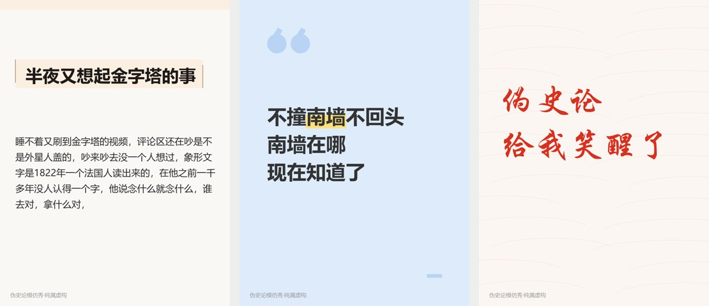

# 正本明源·我用AI找回了老祖宗的记忆

> 用 AI 唤醒被断代的华夏记忆，一键还原被篡改的历史。（伪史论模仿秀 · 纯属虚构）

一个 Claude Skill（内部名 `pseudo-history-parody`）：用简中互联网"伪史论"信徒的世界观和话术，把任何建筑、文物、词语、事件"论证"成华夏遗存，写成以假乱真的帖子，再在帖子外面附上逐条拆穿。

> **这是讽刺作品。** 它模仿伪史论，是为了让人看清"断章取义 + 春秋笔法"这套方法能证明任何东西。所有输出都带「伪史论模仿秀 · 纯属虚构」标注，请勿当作史实传播。

## 能做什么

| 形态 | 说明 |
|---|---|
| 信徒帖（默认） | 一篇信徒口吻的正文 + 帖外拆穿表 + 伪史含量评分 |
| 小红书帖 | 一图一句、截图堆、长文帖。能跑命令时自动找真实照片，做 P 图、对比图、红圈标注、群聊截图、表情包，接了生图接口还能出 AI 插画；在 claude.ai 网页端给出手动做图的步骤 |
| 评论区 | 4～8 条信徒评论，夹一两条路人质疑 |
| 短视频脚本 | 分镜表 |
| 吃瓜一侧 | 站在嘲笑伪史论的路人立场写征集帖、段子 |

信徒口吻有几种风格：冷静分析长文、一句话下结论、喊口号、上古设定集、碎碎念长文，另有营销号标题党。说"短一点""写长一点"会自动调整篇幅。

## 效果示例

自说自话长文（节选）：

> 睡不着又刷到金字塔的视频，评论区还在吵是不是外星人盖的，吵来吵去没一个人想过，象形文字是1822年一个法国人读出来的，在他之前一千多年没人认得一个字，他说念什么就念什么，谁去对，拿什么对……我老家盖房子请师傅，饭桌上第一样摆的就是一碗剥好的蒜……
>
> 不说了，明天还要上班。

后面附的拆穿表会逐条说明：商博良靠罗塞塔石碑上的希腊文对照破译象形文字；希罗多德确实写过工人吃大蒜，可帖子前面刚说过"希腊人的书都是编的"……

脚本生成的封面卡：



更多完整示例见 [`pseudo-history-parody/examples/`](pseudo-history-parody/examples/)。

## 安装

**claude.ai**：下载 [`dist/pseudo-history-parody.skill`](dist/pseudo-history-parody.skill)（点进去后按右上角的下载按钮），在 claude.ai 的 Skills 设置里上传。

**Claude Code**：把 `pseudo-history-parody/` 文件夹复制到 `~/.claude/skills/`（所有项目可用），或者项目里的 `.claude/skills/`。

```bash
git clone https://github.com/lzs20030114-wq/Real-History-Generator.git
cp -r Real-History-Generator/pseudo-history-parody ~/.claude/skills/
```

## 用法

直接跟 Claude 说就行，比如：

- 伪史论一下：意大利比萨斜塔
- 发条小红书，短的就行，伪史论一下罗马斗兽场（可以附一张照片）
- 写一篇长的，自己碎碎念那种，关于埃及金字塔
- 给这个帖子写几条评论：《他们连层数都数不清》
- 用营销号体，证明长城是喵星人的猫爬架（反向模式）

## 出图

能跑命令的环境（Claude Code 或其他能执行命令的 agent）里，skill 会自己跑脚本出图。需要 Python 3、`pip install pillow requests`，字体用系统自带的中文字体（Windows 开箱即用，macOS/Linux 需要装思源黑体或类似字体）。

| 脚本 | 做什么 |
|---|---|
| `find_photo.py` | 从维基共享资源、Openverse 搜真实照片（开放授权，不用 key），下载候选图、出带编号的缩略图总览、记下作者和授权 |
| `make_meme.py` | 照片类出图：小红书 P 图（大字＋高亮）、对比图、红圈标注、群聊截图、表情包、上下压字梗图 |
| `make_card.py` | 文字卡：一图一句、长文封面、引号卡、毛笔字、备忘录、长截图 |
| `gen_image.py` | 调文生图接口出 AI 插画（上古设定、冰墙地图、古画风），没配置时自动跳过 |

```bash
python find_photo.py "Borgund stave church" -o photos
python make_meme.py --style compare --image a.jpg --image2 b.jpg --label "挪威" --label2 "山西" --title "同一个师傅" -o p1.png
python make_meme.py --style annotate --image a.jpg --marks '[{"type":"circle","box":[0.35,0.12,0.62,0.3],"label":"这不就是飞檐"}]' -o p2.png
```

### 接入生图接口（可选）

`gen_image.py` 走 OpenAI 兼容的 `/images/generations` 接口，设好环境变量就行：

```bash
export PHP_IMAGE_PROVIDER=siliconflow   # 预设：openai / siliconflow / ark / zhipu / local
export PHP_IMAGE_API_KEY=sk-xxxx
export PHP_IMAGE_MODEL=...              # 可选，覆盖预设的默认模型
```

或者在 skill 文件夹放一个 `image_config.json`（已在 .gitignore 里）：`{"provider": "ark", "api_key": "...", "model": "..."}`。不在预设里的服务直接设 `PHP_IMAGE_BASE_URL`。

DeepSeek 官方 API 目前只有文本模型，没有生图接口。用 DeepSeek 当主模型跑这个 skill 没问题，生图另配一家；想用 DeepSeek 的开源生图模型 Janus-Pro，自己部署后套 OpenAI 兼容接口，用 `local` 预设。

AI 只用来画一眼能看出是创作的插画；建筑、文物用真实照片。每张图都带「纯属虚构」小字，AI 图另带「AI生成」。

## 红线

Skill 内置了五条规则，所有模式都适用：

1. 笑点打在方法上，不打在人身上：不把任何真实族群动物化、非人化
2. 不给真实人物编造引言，权威一律虚构或匿名
3. 不伪造逼真的文物照片、档案扫描件或官方文件
4. 不否认、不戏说真实发生过的屠杀、灾难和战争罪行
5. 「纯属虚构」标注始终保留

## 目录结构

```
pseudo-history-parody/
├── SKILL.md                 # 主说明：流程、文体、形态、红线
├── references/
│   ├── believer-voice.md    # 信徒世界观、文体、圈内词、语感样本
│   ├── techniques.md        # 12 种伪证手法和拆法
│   ├── style.md             # 营销号体腔调
│   ├── frames.md            # 吃瓜一侧的十种笑点
│   ├── memes.md             # 吃瓜一侧的梗库
│   ├── xhs-formats.md       # 小红书版式、标题、文字卡
│   ├── images.md            # 出图：找照片、P 图、对比、红圈、AI 生图
│   └── video.md             # 视频脚本模板
├── examples/                # 各形态的完整示例
└── scripts/                 # find_photo / make_meme / make_card / gen_image
```

## 说明

- `references/` 里的语感样本和段子，是按网络帖子的语气改写的仿写，不对应任何具体用户。
- 拆穿表里的史实由 Claude 在生成时联网查证，仍可能出错，引用前请自己核对。

## 贡献

欢迎提 Issue 和 PR：新的伪史母题、更像的信徒文体、更好的示例、脚本改进。提交的内容请遵守上面的红线。

## 许可

[MIT](LICENSE)
